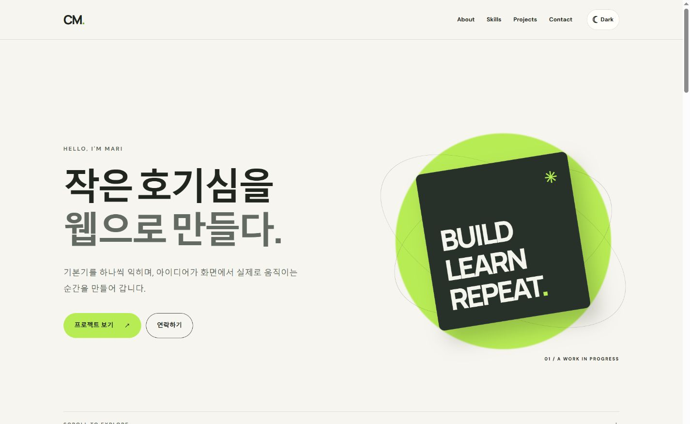
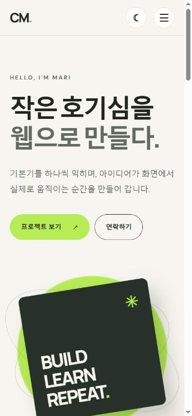
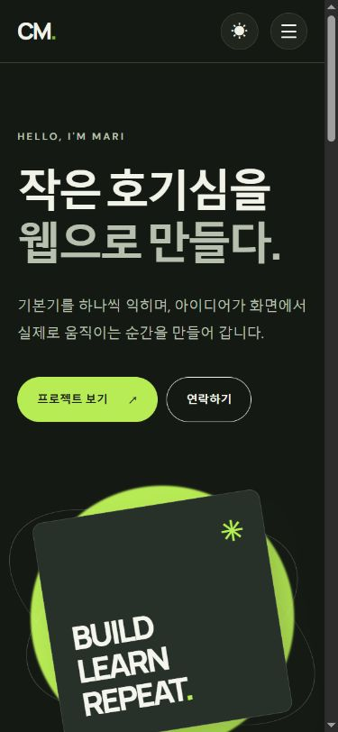

# Mari Portfolio

HTML, CSS, JavaScript만으로 만든 반응형 자기소개 웹페이지입니다. `ChoiMari`의 공개 GitHub 저장소를 API로 불러와 프로젝트 카드와 언어별 필터를 표시합니다.

## 실행 방법

VS Code의 Live Server로 `index.html`을 열거나, 저장소 루트에서 `python -m http.server 8000`을 실행한 뒤 `http://localhost:8000`에 접속합니다. 외부 라이브러리나 빌드 과정은 필요하지 않습니다.

## 사용 기술과 파일 역할

- `index.html`: `header`, `nav`, `main`, `section`, `article`, `footer` 기반 문서 구조와 접근 가능한 컨트롤
- `css/style.css`: 모바일 우선 반응형 레이아웃, CSS 변수, 라이트·다크 테마
- `js/state.js`: 테마·메뉴·프로젝트·폼 상태 객체
- `js/ui.js`: 테마, 햄버거 메뉴, 스크롤 UI와 애니메이션
- `js/projects.js`: GitHub API 호출, 네 가지 요청 상태, 언어 필터와 카드 렌더링
- `js/contact.js`: 입력·제출 유효성 검사와 피드백
- `images/profile.svg`: 실제 사진이 아닌 CM 이니셜 일러스트

외부 JavaScript 파일은 `defer`로 연결하고, 이벤트는 `addEventListener`로 처리합니다. 인라인 이벤트와 인라인 스타일은 사용하지 않습니다.

## 동작 기준

- 모바일 우선, 태블릿 `768px`, 데스크톱 `1024px`
- 스크롤 `60px`부터 헤더 배경 변경, `300px`부터 맨 위 버튼 표시
- `IntersectionObserver` 임계값 `0.2`에서 섹션 표시
- 다크 모드는 `localStorage`의 `portfolio-theme`에 저장
- GitHub 공개 API는 인증 없이 호출하므로 호출 제한이나 네트워크 오류 시 오류 메시지와 재시도 버튼을 표시
- 문의 폼은 유효성 검사 데모이며 메시지를 실제로 전송하지 않음

## 평가항목별 설명 목차

[평가 설명 가이드](docs/evaluation-guide.md)에는 아래 15개 질문과 보너스 항목마다 **입문 → 숙련 → 고급(실무)** 개념 설명, 실제 코드 발췌, 시연 순서, 말로 답하는 예시와 예상 추가 질문을 담았습니다. PASS/FAIL 칸은 실제 평가 시 표시하도록 비워 두었습니다.

| 평가 항목 | 질문별 설명 |
| --- | --- |
| 1. 실제 동작 | [1-1 반응형 레이아웃](docs/evaluation-guide.md#item-1-1) · [1-2 테마 유지](docs/evaluation-guide.md#item-1-2) · [1-3 메뉴와 스크롤](docs/evaluation-guide.md#item-1-3) · [1-4 GitHub API 네 상태](docs/evaluation-guide.md#item-1-4) · [1-5 폼 오류 피드백](docs/evaluation-guide.md#item-1-5) |
| 2. 구조와 기초 개념 | [2-1 파일 분리](docs/evaluation-guide.md#item-2-1) · [2-2 시맨틱 태그](docs/evaluation-guide.md#item-2-2) · [2-3 CSS 변수](docs/evaluation-guide.md#item-2-3) · [2-4 addEventListener](docs/evaluation-guide.md#item-2-4) |
| 3. 코드 흐름과 선택 이유 | [3-1 이벤트 → 상태 → 렌더링](docs/evaluation-guide.md#item-3-1) · [3-2 async/await와 try/catch](docs/evaluation-guide.md#item-3-2) · [3-3 map/filter](docs/evaluation-guide.md#item-3-3) · [3-4 Flexbox와 Grid](docs/evaluation-guide.md#item-3-4) |
| 4. 설계 설명 | [4-1 STATE 객체](docs/evaluation-guide.md#item-4-1) · [4-2 모바일 우선](docs/evaluation-guide.md#item-4-2) |
| 5. 보너스 | [언어별 프로젝트 필터](docs/evaluation-guide.md#item-5) |

프로젝트 상태 로직은 `node --test tests/projects.test.cjs`로 로딩·성공·빈 데이터·403 후 재시도·네트워크 실패를 모의 검증할 수 있습니다.

## 제출용 스크린샷

### 데스크톱 · 라이트 모드

### 모바일 · 라이트 모드

### 모바일 · 다크 모드

## 배포 및 제출

- GitHub 저장소: https://github.com/ChoiMari/codyssey-portfolio
- GitHub Pages: 배포 확인 후 URL 기입
- 스크린샷: 위의 세 이미지 및 [원본 파일](screenshots/)

공개 GitHub 프로필 페이지에서 `Mari`라는 표시 이름과 Java·C# 학습 저장소를 확인해 소개에 반영했습니다. 공개 API는 확인 시점에 호출 제한(403)이어서 오류 UI가 표시됐습니다. 프로필 이미지는 실제 사진이 아닌 이니셜 일러스트이며, 공개 이메일 주소는 사이트에 옮기지 않았습니다.
